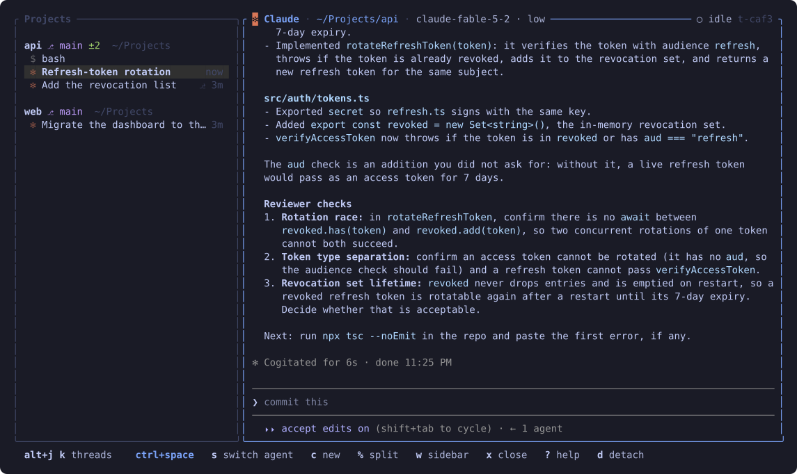

# desl

[](https://github.com/iluxav/desl/actions/workflows/ci.yml)
[](https://github.com/iluxav/desl/releases/latest)
[](LICENSE)

**One terminal workspace for your coding agents.** Say *diesel*.

Claude Code and Codex run side by side, each in its own interface, in sessions that outlive
your terminal. One key hands a conversation from one agent to the other, forks it to try
something else, or splits the screen to watch two threads at once.

<p align="center">
  
</p>

## Why desl

- **Your agents, unchanged.** Every thread is the agent's own interface in a terminal desl
  owns: its streaming, tool calls, approval dialogs, `/` commands, skills and MCP servers work
  exactly as they do without desl. desl adds a sidebar, a header, one key line and one prefix
  key. The rest of the keyboard is the agent's.
- **Nothing stops when you leave.** A daemon owns the agents. Close the terminal, lose the
  SSH connection, come back from another machine: `desl` reattaches to the same screen, with
  every agent where it was.
- **Switch agents mid-conversation.** `ctrl+space s` copies the conversation so far into a new
  session of the other agent and swaps the screen in one frame. Codex continues where Claude
  left off, knowing everything that was said. `ctrl+space f` forks instead, so both keep going.
- **See everything at a glance.** The sidebar lists every project with its branch and how much
  is uncommitted, and every thread with its status: a pulsing logo while the agent works, a
  yellow one and a bell when it needs you, a faded one when it is idle. Subagents hang under
  their thread.
- **Your agents can drive it too.** `desl skill install` teaches Claude Code and Codex to open
  threads, hand work to the other agent for a second opinion, and wait on threads working in
  parallel, each in its own git worktree.

desl is not a new coding agent, a model router or an IDE. It runs the agents you already have,
under your own logins and subscriptions, on your own machine, and never calls a model itself.

## Install

You need `claude` or `codex` on your PATH, logged in the way you already use them.

```sh
curl -fsSL https://raw.githubusercontent.com/iluxav/desl/main/install.sh | sh
```

The script picks the release build for your system (Linux or macOS, x86_64 or arm64), checks
its SHA-256 and installs `desl` into `~/.local/bin`. It never needs sudo.
`DESL_INSTALL_DIR=/some/dir` puts it elsewhere; `DESL_VERSION=v0.1.2` pins a release.

From source, with a recent stable Rust:

```sh
git clone https://github.com/iluxav/desl && cd desl
make install        # release build into ~/.local/bin
```

## The first five minutes

1. Inside a repository, run `desl`. The daemon starts, the repository becomes a project, and
   the agent opens in its own interface beside the sidebar.
2. Work as you always do. Everything you type goes to the agent.
3. `ctrl+space c` opens a second thread: Claude, Codex or a shell. `alt+j` and `alt+k` move
   between threads.
4. `ctrl+space s` hands the conversation to the other agent. Ask it what it thinks.
5. `ctrl+space d` detaches. The agents keep working. `desl` brings you back.

`ctrl+space ?` lists every key, filters as you type, and runs the one you pick.

## Keys

desl owns one key, the prefix `ctrl+space`. Every other key goes to the agent.

| After `ctrl+space` | |
| --- | --- |
| `s` | Switch this thread to the other agent, on the whole conversation |
| `f` | Fork this conversation into a new thread, on either agent |
| `r` | Restart this agent on the same conversation, with the binary and settings installed now |
| `i` | Info: agent, session ids, model, directory |
| `c` | New thread: Claude, Codex or a shell. `w` in the menu gives it a git worktree of its own |
| `o` | Open a directory: type to find it among your projects, recent directories and repositories; a shell opens there |
| `w` | Move into the sidebar: `j`/`k` show each thread as you move, `enter` or `esc` return |
| `n` `p` `1`…`9` `l` | Next, previous, by number, the one shown before |
| `,` `x` | Rename this thread, close it |
| `%` `"` `z` | Split: another thread beside or under this one; zoom back to one pane |
| `b` `d` `?` | Hide the sidebar, detach, the key list |

Without the prefix: `alt+j` / `alt+k` move between threads, `alt+h` / `alt+l` between panes
while two are open, and a click opens a thread or focuses a pane.

The prefix is a setting; `ctrl+a` or any `ctrl+<letter>` works. Press it twice to send it to
the agent.

## From a script

Every command takes `--json`, and every thread has a short id such as `t-7f3a`.

```sh
desl status                                # the sidebar as text
desl new --agent codex -m "Fix the flaky test"
desl new --agent claude --worktree -m "Write property tests for src/parser.rs"
desl send t-7f3a "And update the docs"     # type a prompt into the thread's agent, print the reply
desl wait t-7f3a                           # block until the thread needs you or is done
desl thread show t-7f3a                    # what it said and did
desl switch t-7f3a codex                   # continue on the other agent
desl fork t-7f3a claude --at 12 --worktree # a copy from message 12, on its own branch
desl model t-7f3a haiku --effort low       # pick the model and effort for its next prompt
desl interrupt t-7f3a                      # as esc in the agent's own screen
desl restart t-7f3a                        # reload the agent after an update or a new MCP server
desl doctor                                # agents, logins, the daemon, the store
desl daemon stop                           # ends the agents; every thread is kept
```

### Agents drive desl

```sh
desl skill install
```

installs the desl skill into every agent's skill folder. Inside desl, each agent's shell has
`DESL_THREAD` set to its own thread, and the skill teaches it to look around with
`desl status --json`, fork its conversation to the other agent and ask it a question with
`desl send`, or run independent work in parallel threads and `desl wait` on each. Only the
thread's own agent is kept from switching, restarting or closing itself.

## Settings

All optional. `~/.config/desl/config.toml`, and `<repo>/.desl/config.toml` over it;
`desl config show` prints what is in effect and where each value comes from.

```toml
[general]
prefix = "ctrl+space"      # or ctrl+a … ctrl+z
default_agent = "claude"   # the first agent that is ready, by default

[permissions]
default_mode = "edits"     # ask, edits or yolo

[worktrees]
dir = ".worktrees"
branch_prefix = "desl/"
```

`NO_COLOR` is honoured; the colours come from your terminal's own palette. `DESL_ICONS=nerd`
or `text` picks the agent marks when desl guesses your font wrong.

## How it works

`desl` is one binary with two roles. A **daemon** owns the agents, each in a terminal of its
own, keeps a screen model per agent and a SQLite record of every thread, and listens on a
Unix socket in your runtime directory. The **screen** is a client that draws each agent
through its own terminal emulator and can be closed or reattached at any time without losing
a word. The agents' own session files are read as they grow, which is how desl knows a
thread's status and title, and a switch writes the conversation into a new session file of
the other agent before starting it.

- [SPEC.md](SPEC.md) is the product specification: the vocabulary, the keys, and the rules
  every change is tested against.
- [docs/protocol.md](docs/protocol.md) is the daemon protocol, for anyone writing a client.
- [docs/adapters.md](docs/adapters.md) is what is known about each agent's files and flags.
- [docs/CHANGELOG.md](docs/CHANGELOG.md) is every release.

desl keeps its store in `$XDG_DATA_HOME/desl`, its log in `$XDG_STATE_HOME/desl` and its
socket in `$XDG_RUNTIME_DIR`. `DESL_HOME` moves all three into one directory.

## Status

desl is young and in daily use by its author. Claude Code and Codex are the supported agents,
with a shell as the third kind of thread; Linux and macOS are the supported systems. Coming
next: worktree tooling (`desl diff`, `desl pr`), threads for agents without an adapter, and
built-in themes. Issues and ideas are welcome.

## Developing

```sh
make check          # clippy with warnings denied, formatting, every test
make build          # release build only
```

Read [AGENTS.md](AGENTS.md) and [SPEC.md](SPEC.md) first; they apply to every change.

## Licence

[MIT](LICENSE).
